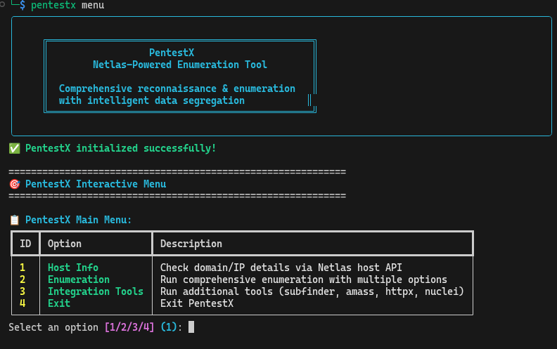

# PentestX 🎯

<div align="center">
  
</div>

[](https://python.org)
[](LICENSE)
[](https://github.com/pentestx/pentestx)

**PentestX** is a comprehensive reconnaissance and enumeration tool designed for cybersecurity professionals, penetration testers, and bug bounty hunters. Built on the robust Netlas API, PentestX provides systematic target enumeration with intelligent data organization and optional third-party tool integration.

## 🌟 What is PentestX?

PentestX leverages the power of **Netlas** - a comprehensive internet asset database containing billions of records spanning web services, certificates, DNS data, and network infrastructure. Unlike traditional reconnaissance tools that rely on limited data sources, PentestX provides access to Netlas's vast intelligence network for thorough target enumeration.

### Key Features

- **🔍 Comprehensive Enumeration**: Multiple enumeration types via Netlas API
- **🎮 Interactive Interface**: Step-by-step guided workflow with intuitive menus
- **📁 Organized Output**: Automatic result categorization in JSON, CSV, and TXT formats
- **⚡ Intelligent Integration**: Optional third-party tool integration (subfinder, amass, httpx, nuclei)
- **📊 Data Segregation**: Automatic separation of results by type (subdomains, IPs, certificates, etc.)
- **🔧 Flexible Commands**: Both interactive menu and direct command-line interfaces

## 🏆 Perfect for Bug Bounty Hunters

PentestX streamlines reconnaissance workflows commonly used in bug bounty hunting:

### **Subdomain Discovery**
Discover extensive subdomain lists using Netlas's comprehensive database, then optionally enhance with additional tools like subfinder and amass for maximum coverage.

### **Attack Surface Mapping**
Systematically enumerate all discoverable assets including:
- Subdomains and domain variations
- IP addresses and hosting information  
- SSL certificates and associated domains
- DNS records and infrastructure details
- WHOIS information for domains and IPs

### **Integration Pipeline**
Run additional security tools on discovered assets:
- **httpx**: Probe live web services and gather response information
- **nuclei**: Automated vulnerability scanning with community templates
- **subfinder**: Additional subdomain enumeration from multiple sources
- **amass**: Advanced network mapping and subdomain discovery

## 🚀 Quick Start

### Prerequisites

- **Python 3.10 or higher** - [Download here](https://python.org/downloads/)
- **Netlas API Key** - [Get your free key](https://netlas.io/) (required)
- **Git** - For installation
- **Internet Connection** - For API access

### 📥 Installation

#### Option 1: One-Click Installation (Recommended)

```bash
# Clone and run the installer
git clone https://github.com/pentestx/pentestx.git
cd pentestx
chmod +x install.sh
./install.sh
```

#### Option 2: Manual Installation

```bash
# Clone the repository
git clone https://github.com/pentestx/pentestx.git
cd pentestx

# Create virtual environment
python3 -m venv pentestx-env
source pentestx-env/bin/activate

# Install dependencies
pip install -r requirements.txt

# Install PentestX
pip install -e .
```

### ⚙️ Configuration

1. **Create your configuration file**:
   ```bash
   cp .env.example .env
   nano .env
   ```

2. **Add your Netlas API key**:
   ```env
   NETLAS_API_KEY=your_actual_api_key_here
   ```

3. **Test your installation**:
   ```bash
   python -m pentestx --help
   ```

## 🎯 How to Use PentestX

### Interactive Mode (Recommended for Beginners)

Launch the guided interface:

```bash
python -m pentestx menu
```

The interactive menu provides:
1. **Host Info** - Quick domain/IP details lookup
2. **Enumeration Options** - Choose from 8 different enumeration types
3. **Integration Tools** - Run additional security tools on results

### Available Enumeration Types

1. **Subdomain Enumeration** - Discover subdomains via Netlas domains API
2. **Domain by IP Search** - Find domains hosted on specific IP addresses  
3. **IP WHOIS Search** - Search IP WHOIS data via Netlas whois-ip API
4. **DNS Search** - Search DNS records via Netlas domains API
5. **Domain WHOIS Search** - Search domain WHOIS data via Netlas whois-domain API
6. **Response Search** - Search response data via Netlas responses API
7. **Certificate Search** - Search certificates by organization via Netlas cert API
8. **Comprehensive Enumeration** - Run all enumeration methods combined

### Command Line Mode (For Advanced Users)

#### Basic Target Enumeration
```bash
# Comprehensive enumeration
python -m pentestx scan apple.com

# Specific enumeration type
python -m pentestx scan apple.com --type subdomain

# Custom output format
python -m pentestx scan apple.com --format csv
```

#### Certificate Search
```bash
# Search certificates by organization
python -m pentestx cert "Apple Inc."

# Extract specific fields to text format
python -m pentestx cert "Google LLC" --extract common_name --format txt
```

#### Configuration Management
```bash
# Display current configuration
python -m pentestx config

# Show version information
python -m pentestx version
```

## 📁 Understanding Your Results

PentestX automatically organizes findings into structured files:

```
output/
├── apple_com_subdomains_2025_08_15_143022.json    # All discovered subdomains
├── apple_com_ips_2025_08_15_143022.json          # IP addresses found
├── apple_com_summary_2025_08_15_143022.json      # Enumeration summary
└── apple_com_mappings_2025_08_15_143022.json     # Domain-to-IP mappings
```

### Output Formats
- **JSON** - Structured data, perfect for automation and integration
- **CSV** - Spreadsheet-compatible for analysis and reporting
- **TXT** - Human-readable format for quick review

## 🔧 Third-Party Tool Integration

PentestX can integrate with popular security tools to enhance reconnaissance capabilities:

### Optional Tools (Auto-detected when available)

#### **Subfinder** - Additional Subdomain Discovery
```bash
# Install with Go
go install -v github.com/projectdiscovery/subfinder/v2/cmd/subfinder@latest
```

#### **Amass** - Advanced Network Mapping  
```bash
# Install with Go
go install -v github.com/OWASP/Amass/v3/...@master
```

#### **HTTPx** - HTTP Service Probing
```bash  
# Install with Go
go install -v github.com/projectdiscovery/httpx/cmd/httpx@latest
```

#### **Nuclei** - Vulnerability Scanning
```bash
# Install with Go  
go install -v github.com/projectdiscovery/nuclei/v3/cmd/nuclei@latest
```

PentestX automatically detects available tools and offers integration options in the interactive menu.

## 💡 Example Workflows

### Basic Reconnaissance Workflow
1. **Start enumeration**: `python -m pentestx scan target.com`
2. **Review results** in organized JSON/CSV output files
3. **Run integrations** on discovered assets via the menu system
4. **Analyze findings** for further investigation

### Bug Bounty Workflow
1. **Launch interactive mode**: `python -m pentestx menu`
2. **Use comprehensive enumeration** for maximum asset discovery
3. **Run integration tools** on discovered subdomains
4. **Export results** in preferred format for analysis
5. **Follow up** on interesting findings manually

### Certificate Intelligence
1. **Search by organization**: `python -m pentestx cert "Target Company"`
2. **Extract domains** from certificate data
3. **Use discovered domains** for further enumeration
4. **Cross-reference** with subdomain enumeration results

## ❓ Troubleshooting

### Common Issues

**"No API key configured"**
- Edit your `.env` file and add: `NETLAS_API_KEY=your_key_here`

**"Python version not supported"**
- Install Python 3.10 or higher from [python.org](https://python.org)

**"Command not found"**
- Activate your virtual environment: `source pentestx-env/bin/activate`
- Or use full path: `python -m pentestx`

**"No results found"**
- Check your internet connection
- Verify your API key is valid at [netlas.io](https://netlas.io)
- Ensure the target domain exists and is reachable

### Getting Help

- **Built-in Help**: `python -m pentestx --help`
- **Configuration Check**: `python -m pentestx config`
- **Version Info**: `python -m pentestx version`

## 🔒 Important Security & Legal Notes

⚠️ **Authorization Required**: Only use PentestX on domains and systems you own or have explicit written permission to test. Unauthorized reconnaissance may violate laws and policies.

⚠️ **API Key Security**: Keep your Netlas API key private. Never share it or commit it to version control.

⚠️ **Rate Limits**: PentestX respects API rate limits automatically, but be mindful of extensive scanning that may impact service availability.

⚠️ **Responsible Disclosure**: When used for security research, follow responsible disclosure practices for any vulnerabilities discovered.

## 📞 Support & Community

- **🐛 Bug Reports**: [GitHub Issues](../../issues)
- **💡 Feature Requests**: [GitHub Discussions](../../discussions)
- **📖 Documentation**: Built-in help and command-line assistance
- **🔄 Updates**: Watch the repository for new releases

## 📄 License

PentestX is released under the MIT License. See [LICENSE](LICENSE) for details.

## 🙏 Credits

Built with powerful technologies:
- **[Netlas](https://netlas.io/)** - Comprehensive internet asset database
- **[Rich](https://rich.readthedocs.io/)** - Beautiful terminal interfaces
- **[Typer](https://typer.tiangolo.com/)** - Modern CLI framework
- **[Pydantic](https://pydantic.dev/)** - Data validation and settings

---

**Ready to start your reconnaissance journey?**

```bash
git clone https://github.com/L4stPL4Y3R/pentestnetlas.git && cd pentestx && ./install.sh
```

